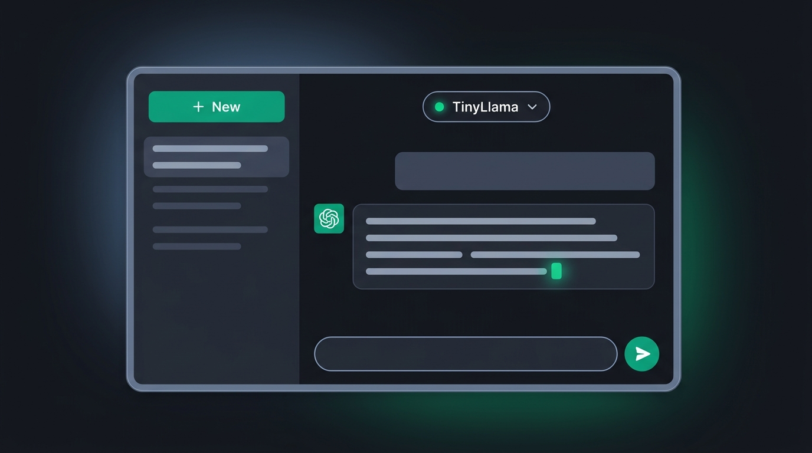
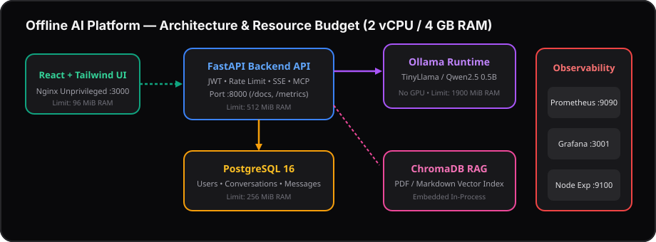

<div align="center">


# Offline AI Platform

**Private, ChatGPT-style Offline AI Platform engineered for 2 vCPU / 4 GB RAM (No GPU)**  
Powered by **Ollama** (`tinyllama` &amp; `qwen2.5:0.5b`), **FastAPI**, **React + TypeScript + TailwindCSS**, **PostgreSQL**, **ChromaDB RAG**, **Prometheus &amp; Grafana**, and **Kubernetes**.

[](https://aishwar2.github.io/offline-ai-platform/)
[](https://github.com/aishwar2/offline-ai-platform/actions/workflows/ci-cd.yml)
[](backend/app/main.py)
[](frontend/src/App.tsx)
[](docker-compose.yml)
[](kubernetes/kustomization.yaml)

<br />



</div>

---

## Live Interactive Demo

Try the ChatGPT-style interface directly in your browser (client-side simulated TinyLlama / Qwen2.5 streaming, dark mode, model switching, export, and RAG demo):

- **Live Demo URL**: **[https://aishwar2.github.io/offline-ai-platform/](https://aishwar2.github.io/offline-ai-platform/)**
- Or click **"Launch Interactive Live Demo"** on the sign-in screen when running the frontend locally (`npm run dev` or `?demo=1`).

> **Note for repository owners:** Ensure GitHub Pages is set to **GitHub Actions** in `Settings -> Pages -> Build and deployment -> Source` so [.github/workflows/pages.yml](.github/workflows/pages.yml) publishes automatically on pushes to `main`.

---

## System Architecture

<div align="center">
  
</div>

---

## Key Capabilities

| Icon | Area | Highlights |
| :---: | --- | --- |
| 🔐 | **Authentication & RBAC** | HS256 JWT auth, bcrypt hashing, registration/login, profile settings, admin user management |
| 💬 | **ChatGPT-Style UI** | Streaming SSE responses, dark mode, responsive sidebar, chat history, Markdown & JSON export |
| 🧠 | **Local AI (Ollama)** | `tinyllama` default + `qwen2.5:0.5b` switching, prompt/completion token tracking, latency metrics |
| 🗄️ | **PostgreSQL + ORM** | SQLAlchemy 2.0 models (`users`, `conversations`, `messages`, `documents`) + SQL schema |
| 📚 | **RAG, Agents & MCP** | PDF/Markdown upload with ChromaDB retrieval, Plan-Retrieve-Synthesize agent, MCP JSON-RPC 2.0 |
| 📊 | **Monitoring Stack** | Prometheus (`/metrics`), Node Exporter, pre-provisioned Grafana CPU/RAM/Latency/Token dashboards |
| 🛡️ | **Enterprise DevOps** | Non-root containers, rate limiting, CORS, Kubernetes (`kustomize`), 5-stage GitHub Actions CI/CD |

---

## Repository Structure

```text
offline-ai-platform/
├── backend/                  # FastAPI API, SQLAlchemy ORM, Ollama/RAG/MCP services, pytest suite
├── frontend/                 # React + TypeScript + TailwindCSS SPA + Live Demo mode + Nginx
├── ollama/                   # Non-root Ollama container & model pre-pull entrypoint
├── database/                 # PostgreSQL schema & development seed SQL
├── monitoring/               # Prometheus scrape config & Grafana provisioned dashboards
├── kubernetes/               # Namespace, ConfigMap, Secrets, Deployments, Services, Ingress
├── docs/                     # Assets (logo, banner, diagrams) & Deployment/Troubleshooting guides
├── scripts/                  # Setup, model pull, and health-check helper scripts
├── .github/workflows/        # CI/CD pipeline (ci-cd.yml) & GitHub Pages demo deploy (pages.yml)
├── docker-compose.yml        # Full-stack Compose definition optimized for 2 CPU / 4 GB RAM
├── architecture.md           # System architecture diagram & resource budget breakdown
└── .env.example              # Environment configuration template
```

---

## Quick Start (Docker Compose)

```bash
git clone git@github.com:aishwar2/offline-ai-platform.git
cd offline-ai-platform
chmod +x scripts/*.sh
./scripts/setup.sh
```

Once running, access:
- **Chat UI**: http://localhost:3000
- **Swagger API Docs**: http://localhost:8000/docs
- **Prometheus**: http://localhost:9090
- **Grafana**: http://localhost:3001 (credentials from `.env`)

Pull an optional ultra-light alternative model (`qwen2.5:0.5b`):

```bash
./scripts/pull-models.sh qwen2.5:0.5b
```

---

## Documentation Index

- [Architecture & Resource Budget](architecture.md)
- [Installation Guide](docs/installation-guide.md)
- [Local Development Guide](docs/local-development-guide.md)
- [Kubernetes Deployment Guide](docs/kubernetes-deployment-guide.md)
- [API Documentation](docs/api-documentation.md)
- [Troubleshooting Guide](docs/troubleshooting-guide.md)
