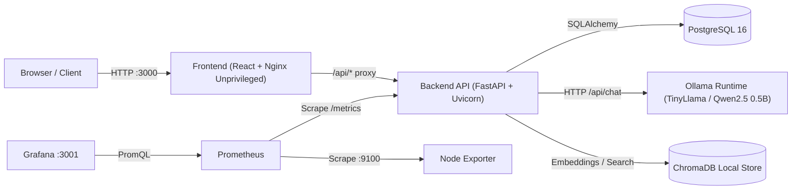

# System Architecture

## High-Level Component Diagram

## Request & Streaming Dataflow

1. **Authentication**: Users register or log in via `/api/v1/auth/*` and receive a signed HS256 JWT. The first registered account automatically receives the `admin` role.
2. **Chat Streaming**: The React UI sends prompts to `POST /api/v1/chat` (`stream=true`). FastAPI persists the user message, retrieves optional RAG context from ChromaDB, and streams NDJSON tokens from Ollama back to the browser as Server-Sent Events (`text/event-stream`).
3. **Telemetry**: On completion, prompt/completion token counts and end-to-end latency (`response_time_ms`) are persisted to PostgreSQL `messages` and exposed on `/metrics` via `prometheus_client`.

## 2 vCPU / 4 GB RAM Resource Budget (No GPU)

| Service | CPU Limit | Memory Limit | Optimization Notes |
| --- | --- | --- | --- |
| **Ollama** | `1.50` | `1900 MiB` | `tinyllama` (~637 MB) or `qwen2.5:0.5b` (~398 MB), `OLLAMA_NUM_PARALLEL=1`, `OLLAMA_MAX_LOADED_MODELS=1` |
| **Backend (FastAPI)** | `0.75` | `512 MiB` | Single Uvicorn worker (`--workers 1`) avoids duplicating in-process ChromaDB state |
| **PostgreSQL 16** | `0.25` | `256 MiB` | Alpine image with connection pool pre-ping |
| **Prometheus** | `0.25` | `256 MiB` | 7-day TSDB retention, 15s scrape interval |
| **Grafana** | `0.25` | `192 MiB` | Provisioned datasource and single overview dashboard |
| **Frontend (Nginx)** | `0.25` | `96 MiB` | Static Vite bundle served by unprivileged Nginx |
| **Node Exporter** | `0.10` | `64 MiB` | Lightweight host CPU & memory metrics |
| **Total Hard Cap** | — | **~3276 MiB** | Leaves >700 MiB headroom on a 4 GB RAM host |
